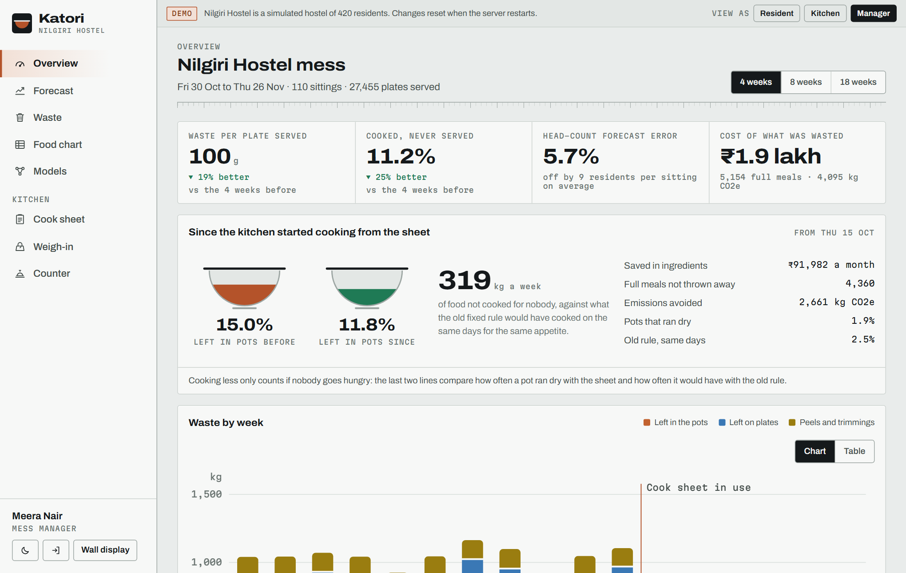
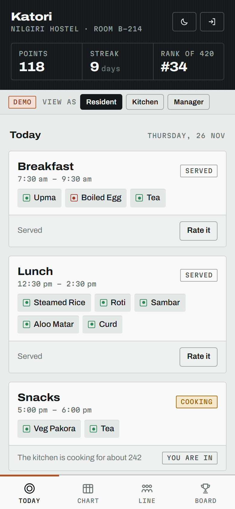
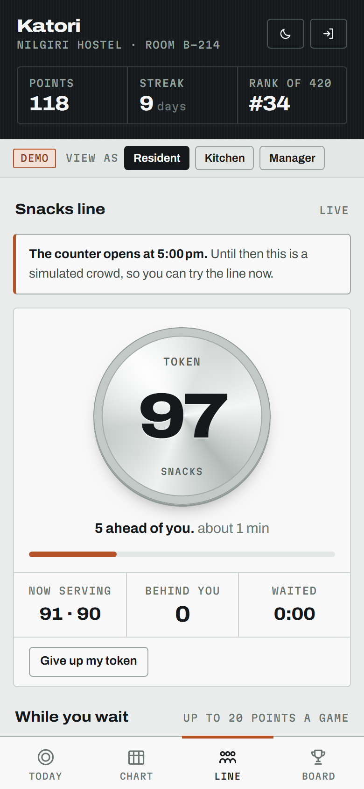
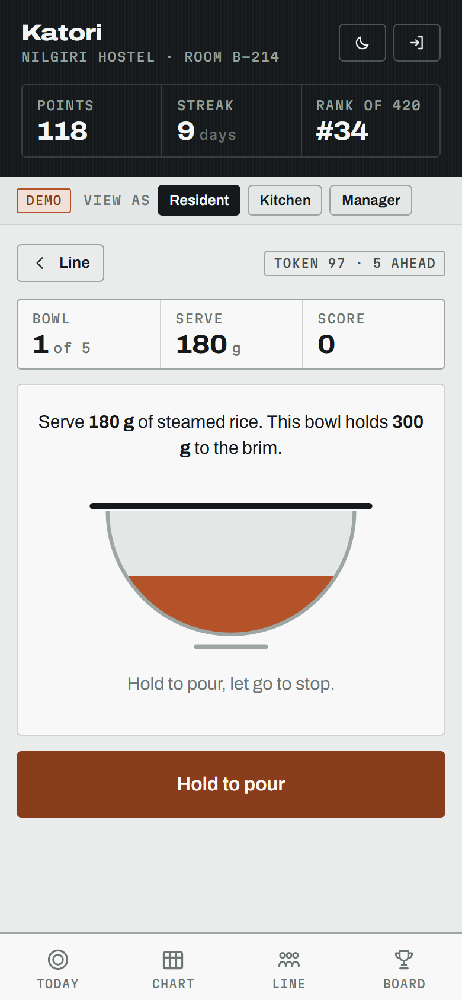
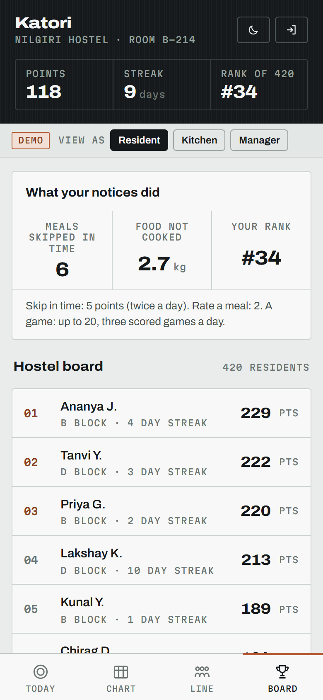
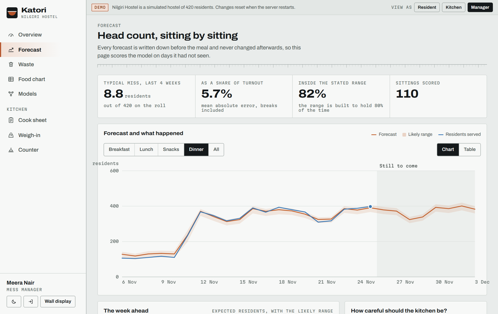
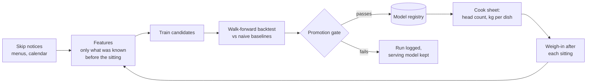
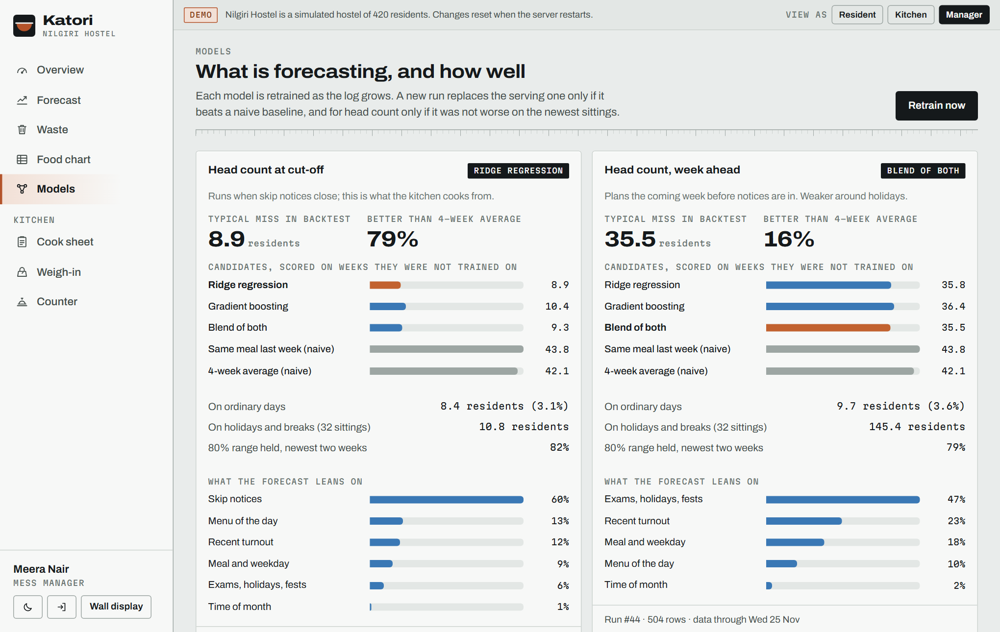
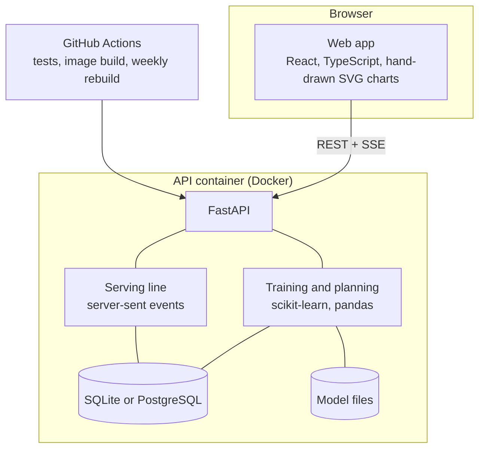

# Katori

**Cook what will be eaten.** Katori is a food-waste platform for hostel messes. It forecasts how many residents will turn up for each meal, tells the kitchen how many kilograms of every dish to cook, weighs what is left, and replaces the serving queue with digital tokens.

A *katori* is the small steel bowl a portion is served in.



## What each person gets

| | |
|---|---|
| **Residents** (phone) | Today's food chart, one tap to skip a meal before the kitchen starts cooking, "I am going home" for a range of days, a queue token with live position and wait time, two short games to play while waiting, ratings, and a hostel leaderboard. |
| **Kitchen** | A cook sheet per sitting: expected head count with a range, kilograms and pieces per dish, raw-material quantities, and the difference from the old fixed rule. A weigh-in form after service. A counter screen that calls the next token. |
| **Mess manager** | Waste by week, dish and sitting, cost and CO2e, forecast accuracy scored on days the model had not seen, the weekly food chart with suggested swaps, and a report on every model and training run. |
| **Dining hall** | A wall display with the tokens being served, the queue length and the menu. |

<p>
  
  
  
  
</p>

## The demo hostel, and what is real about it

The demo runs on **Nilgiri Hostel**, a simulated mess of 420 residents. Attendance, appetite, ratings and the queue are generated by a simulator (`backend/katori/sim/world.py`) that the forecasting code never imports: the models only see what a kitchen would log. Everything downstream of that log is real: the features, the training, the backtests, the model registry and every number on the screens.

The history is replayed the way a mess would adopt the product, so no forecast in it was made by a model that had seen that day:

| Weeks | What the kitchen does |
|---|---|
| 1 to 4 | Only measures (head counts, weights) and cooks by its old fixed rule |
| 5 to 12 | Models are retrained weekly and advise in the background |
| 13 to 18 | The kitchen cooks from the sheet |

Figures from the build of 26 November 2026 (they move a little as the window slides forward):

| Measure | Result |
|---|---|
| Head-count forecast at cut-off, walk-forward backtest | off by 8.9 residents per sitting, against 42.1 for the best naive baseline |
| The same on ordinary days (no holiday or break) | 8.4 residents, 3.1% of turnout |
| Stated 80% range, checked on the newest two weeks | held 82% of the time |
| Cooked food never served, before and after the cook sheet | 15.0% to 11.8% |
| Pots that ran dry, with the sheet and with the old rule on the same days | 1.9% and 2.5% |
| Food not cooked for nobody | about 319 kg a week |

These are results on simulated data. They show that the pipeline works and is evaluated honestly; they are not a claim about any real hostel.



## How the forecasting works



**Four models per kitchen**

| Model | Predicts | Candidates |
|---|---|---|
| Head count at cut-off | residents at a sitting, once skip notices have closed | ridge regression, gradient boosting, a blend; against "same meal last week" and "4-week average" |
| Head count, week ahead | the same, days ahead, without notices | as above |
| Portion per head | how much of each dish one diner really eats | gradient boosting, the dish's own running average, a blend; against the standard portion |
| Queue wait | seconds until someone joining the line is served | gradient boosting against "people ahead times average plating time" |

**Decisions worth knowing about**

- **No peeking.** Every feature of a sitting is built from earlier sittings only. A test rewrites the last ten days of the log and asserts that no earlier feature moves.
- **Notices as structure, not just a feature.** Everyone who gave notice is a certain no-show, so the cut-off model predicts turnout *among residents who did not give notice*. That is why it stays sane when half the hostel leaves for Diwali, an event it has only seen once.
- **Holidays kept out of the averages.** Lags and rolling means skip holidays and breaks, so one empty week does not drag forecasts down for a month.
- **Intervals from the model's own mistakes.** The range around a forecast is the spread of out-of-sample backtest errors on ordinary days. Its coverage is checked on the newest two weeks and reported.
- **A safety margin that is measured.** Kilograms to cook = expected head count x expected take x a margin. The margin is the quantile of the *joint* error of both models at the kitchen's chosen service level (how often a pot may run dry), which the manager can set to lean, balanced or safe.
- **Pots that run dry.** Once a kitchen cooks to the forecast, an empty pot hides how much more people wanted, and a model trained on that learns to cook less every week. The weigh-in asks how many residents reached an empty pot, and the portion target is measured among those who were served.
- **A gate before promotion.** A new run replaces the serving model only if it beats the naive baseline, and for the cut-off model only if it was not more than 10% worse than the serving model on the newest sittings, where the serving model's forecasts were genuinely made in advance.



## Architecture



- **Multi-tenant**: every row carries its kitchen's id and every query is scoped by the signed-in user's kitchen. A test creates a second kitchen and checks it sees nothing of the first.
- **Three roles** with bearer tokens; passwords are hashed with scrypt.
- **Live queue** over server-sent events, opened with a single-use ticket because browsers cannot attach a token to an event stream; it falls back to polling if the stream drops.
- **No scheduler**: free hosting sleeps, so upkeep runs with requests. The first request after a quiet spell brings the kitchen up to date, and a retrain starts in a thread when the serving model has fallen behind the log.
- **Cold starts**: the image is built with the demo hostel replayed and the models trained, so a waking container only replays the days since the build. A weekly workflow rebuilds it.

## Run it locally

Requirements: Python 3.12, Node 22 or newer.

```bash
# API
cd backend
python -m venv .venv
.venv/Scripts/activate            # Windows; on macOS/Linux: source .venv/bin/activate
pip install -r requirements-dev.txt
python -m katori.seed             # replays 18 weeks and trains the models, about a minute
uvicorn katori.main:app --reload  # http://127.0.0.1:8000/api/docs

# Web app, in a second terminal
cd web
npm install
npm run dev                       # http://localhost:5173
```

Or build the web app once (`npm run build` in `web/`) and open http://127.0.0.1:8000: the API serves it.

With Docker: `docker build -t katori . && docker run -p 8000:8000 katori`.

### Settings

| Variable | Default | Meaning |
|---|---|---|
| `DATABASE_URL` | SQLite file in `backend/var` | Use `postgresql://...` for PostgreSQL (install `requirements-postgres.txt`) |
| `KATORI_DEMO` | `1` | Build the demo hostel on an empty database and allow one-click entry |
| `KATORI_SECRET` | random at each start | Signing key for sign-in tokens; set it to keep sessions across restarts |
| `KATORI_CORS_ORIGINS` | the local dev server | Origins allowed to call the API from a browser |
| `KATORI_RETRAIN_DAYS` | `1` | Retrain once the serving model is this many logged days behind |

### A real kitchen

```bash
python -m katori.manage create-kitchen --slug aravali --name "Aravali Mess" --city Jaipur \
    --strength 300 --manager-email warden@example.edu --manager-name "A. Warden"
python -m katori.manage add-user --slug aravali --role kitchen --email cook@example.edu --name "Head Cook"
```

A new kitchen starts with plain estimates (a share of the roll); the models take over after four weeks of weigh-ins.

## Tests

```bash
cd backend
ruff check .
pytest -q        # 36 tests, about 20 seconds
```

The suite replays nine weeks of a smaller hostel and then checks, among other things, that features never use the future, that every serving model beats its baseline, that the gate rejects a worse model, that cooking from the sheet leaves less in the pots, that tokens are served in order, and that kitchens cannot see each other's data.

## Deploy

**API and web app on Render** (free plan)

1. In Render choose *New > Blueprint* and pick this repository. `render.yaml` describes one Docker web service.
2. When it is live, the app is at the service's address.

**Web app on GitHub Pages** (optional, loads instantly while the API wakes up)

1. Repository *Settings > Secrets and variables > Actions > Variables*: add `KATORI_API_URL` with the Render address.
2. *Settings > Pages*: set the source to *GitHub Actions*. The `pages.yml` workflow publishes on every push to `main` that touches `web/`.
3. In `render.yaml`, `KATORI_CORS_ORIGINS` must list the Pages origin.

**Weekly retrain**: add the Render deploy hook as the repository secret `RENDER_DEPLOY_HOOK`; `refresh.yml` then rebuilds the image every Monday.

Free plan limits to know: the service sleeps after 15 idle minutes and takes most of a minute to wake (the landing page says so and offers a game meanwhile), and the demo's data lives inside the container, so anything a visitor changes is gone at the next restart.

## Layout

```
backend/katori/
  sim/world.py        ground truth of the simulated hostel (never imported by the models)
  sim/engine.py       lays out days, closes finished sittings, refreshes forecasts
  ml/features.py      log -> model inputs
  ml/headcount.py     head-count models, backtest, intervals
  ml/portion.py       portion model and the measured safety margin
  ml/waittime.py      queue wait model
  ml/pipeline.py      training entry point, promotion gate, planner
  ml/registry.py      model registry
  services/           analytics, serving line, points, upkeep
  api/                routes by role
  seed.py             builds the demo hostel
  manage.py           sets up real kitchens
backend/tests/        36 tests
web/src/              React app: pages by role, SVG charts, two games
Dockerfile, render.yaml, .github/workflows/
```

## What is next

Hostel mode is the first of two. Planned: restaurant mode (a la carte menus, prep lists, specials that use stock close to expiry), a menu optimiser that balances cost, nutrition and waste, surplus alerts to a partner NGO, and estimating plate waste from a photo.

Portions, costs and CO2e factors in the starter catalogue are rough defaults meant to be edited per kitchen.
